# Rafale d'exemples élémentaires — RetainWall

Généré le 2026-10-25 par `python -m outils.rafale_elementaire`.

Chaque cas compare une grandeur calculée par le logiciel à une **référence analytique citée** (formulaires de résistance des matériaux, Hetényi, Timoshenko & Woinowsky-Krieger, équilibre limite) ou à une propriété physique attendue (symétrie, équilibre, monotonie). Les mêmes cas sont exécutés par les tests automatiques (`backend/tests/validation`). Convention de signes : voir le tableau RDM7 en fin de document.

**Bilan : 45 cas conformes sur 45** — tous conformes.

## Sommaire

- Poutres sans sol (résistance des matériaux, type RDM7) : 14/14 conformes
- Poutres sur fondation de Winkler (Hetényi) : 4/4 conformes
- Plaque sans sol (grillage pseudo-3D contre Timoshenko) : 8/8 conformes
- Écran 2D : équilibre limite, équilibre par phase, convergence : 4/4 conformes
- Écran 2D : balayages de grandeurs physiques : 8/8 conformes
- Pseudo-3D : coupes 2D assemblées contre vraie plaque, double écran : 7/7 conformes

## Poutres sans sol (résistance des matériaux, type RDM7)

### Console encastrée en z = 0, force P en bout (z = L)

Identifiant : `console_force` — conforme (écart max 8.5e-10)

| Grandeur | Attendu | Calculé | Écart | Tolérance | Verdict | Source |
|---|---|---|---|---|---|---|
| flèche en bout | 0,0036 m | 0,0036 m | 2.9e-10 | 1e-09 | conforme | PL³/3EI, formulaire de RDM (Timoshenko, Résistance des matériaux ; Roark 7e éd., tableau 8.1) |
| rotation en bout | 0,0009 rad | 0,0009 rad | 2.3e-10 | 1e-09 | conforme | PL²/2EI |
| moment à l'encastrement | -60 kN·m | -60 kN·m | 0.0e+00 | 1e-09 | conforme | −PL (face chargée comprimée) |
| effort tranchant | 10 kN | 10 kN | 0.0e+00 | 1e-09 | conforme | V = P |
| réaction à l'encastrement | 10 kN | 10 kN | 8.5e-10 | 1e-09 | conforme | ΣF = 0 |
| couple d'encastrement (valeur absolue) | 60 kN·m | 60 kN·m | 4.4e-10 | 1e-09 | conforme | ΣM = 0 |
| V juste sous la force en bout | 10 kN | 10 kN | 0.0e+00 | 1e-09 | conforme | V = P jusqu'au point d'application |
| équilibre des forces (résidu relatif) | 0 | 4,248e-10 | 4.2e-10 (abs.) | 1e-09 | conforme | statique |
| équilibre des moments (résidu relatif) | 0 | 2,178e-10 | 2.2e-10 (abs.) | 1e-09 | conforme | statique |
| V = dM/dz (écart relatif max) | 0 | 5,329e-15 | 5.3e-15 (abs.) | 1e-09 | conforme | RDM |
| q = dV/dz (écart relatif max) | 0 | 0 | 0.0e+00 (abs.) | 1e-09 | conforme | RDM |

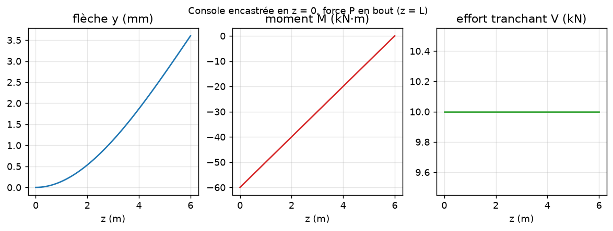

### Console encastrée en z = 0, charge uniforme q (charges nodales cohérentes)

Identifiant : `console_repartie` — conforme (écart max 3.2e-10)

| Grandeur | Attendu | Calculé | Écart | Tolérance | Verdict | Source |
|---|---|---|---|---|---|---|
| flèche en bout | 0,00405 m | 0,00405 m | 3.2e-10 | 1e-09 | conforme | qL⁴/8EI, formulaire de RDM (Timoshenko, Résistance des matériaux ; Roark 7e éd., tableau 8.1) |
| rotation en bout | 0,0009 rad | 0,0009 rad | 2.9e-10 | 1e-09 | conforme | qL³/6EI |
| moment à l'encastrement | -90 kN·m | -90 kN·m | 0.0e+00 | 1e-09 | conforme | −qL²/2 |
| effort tranchant à l'encastrement | 30 kN | 30 kN | 0.0e+00 | 1e-09 | conforme | qL |
| équilibre des forces (résidu relatif) | 0 | 1,795e-10 | 1.8e-10 (abs.) | 1e-09 | conforme | statique |
| équilibre des moments (résidu relatif) | 0 | 9,144e-11 | 9.1e-11 (abs.) | 1e-09 | conforme | statique |
| V = dM/dz (écart relatif max) | 0 | 5,921e-15 | 5.9e-15 (abs.) | 1e-09 | conforme | RDM |
| q = dV/dz (écart relatif max) | 0 | 3,553e-15 | 3.6e-15 (abs.) | 1e-09 | conforme | RDM |
| V nul à l'extrémité libre z = L | 0 kN | 0 kN | 0.0e+00 (abs.) | 1e-08 | conforme | statique |

### Console sous charge uniforme, charges concentrées aux nœuds (comme le moteur, pas 0,1 m) : erreur mesurée

Identifiant : `console_repartie_nodale` — conforme (écart max 9.3e-05)

| Grandeur | Attendu | Calculé | Écart | Tolérance | Verdict | Source |
|---|---|---|---|---|---|---|
| flèche en bout | 0,00405 m | 0,00405 m | 9.3e-05 | 1e-03 | conforme | qL⁴/8EI (charges nodales : erreur O(h²)) |
| moment à l'encastrement | -90 kN·m | -90 kN·m | 0.0e+00 | 1e-09 | conforme | −qL² /2 (statique exacte) |
| équilibre des forces (résidu relatif) | 0 | 1,789e-10 | 1.8e-10 (abs.) | 1e-09 | conforme | statique |
| équilibre des moments (résidu relatif) | 0 | 9,136e-11 | 9.1e-11 (abs.) | 1e-09 | conforme | statique |
| V = dM/dz (écart relatif max) | 0 | 5,921e-15 | 5.9e-15 (abs.) | 1e-09 | conforme | RDM |
| q = dV/dz (écart relatif max) | 0 | 3,553e-15 | 3.6e-15 (abs.) | 1e-09 | conforme | RDM |
| V nul à l'extrémité libre z = L | 0 kN | 0 kN | 0.0e+00 (abs.) | 1e-08 | conforme | statique |

### Poutre sur deux appuis simples, charge uniforme q

Identifiant : `biappuyee_repartie` — conforme (écart max 1.7e-10)

| Grandeur | Attendu | Calculé | Écart | Tolérance | Verdict | Source |
|---|---|---|---|---|---|---|
| flèche au milieu | 0,0004219 m | 0,0004219 m | 1.3e-10 | 1e-09 | conforme | 5qL⁴/384EI, formulaire de RDM (Timoshenko, Résistance des matériaux ; Roark 7e éd., tableau 8.1) |
| moment au milieu | 22,5 kN·m | 22,5 kN·m | 1.7e-10 | 1e-09 | conforme | qL²/8 |
| réaction en z = 0 | 15 kN | 15 kN | 1.4e-10 | 1e-09 | conforme | qL/2 |
| réaction en z = L | 15 kN | 15 kN | 8.6e-11 | 1e-09 | conforme | qL/2 |
| effort tranchant à l'appui z = 0 | 15 kN | 15 kN | 8.6e-11 | 1e-09 | conforme | qL/2 |
| rotation à l'appui | 0,000225 rad | 0,000225 rad | 1.3e-10 | 1e-09 | conforme | qL³/24EI |
| équilibre des forces (résidu relatif) | 0 | 5,621e-11 | 5.6e-11 (abs.) | 1e-09 | conforme | statique |
| équilibre des moments (résidu relatif) | 0 | 2,14e-11 | 2.1e-11 (abs.) | 1e-09 | conforme | statique |
| V = dM/dz (écart relatif max) | 0 | 1,741e-14 | 1.7e-14 (abs.) | 1e-09 | conforme | RDM |
| q = dV/dz (écart relatif max) | 0 | 3,553e-15 | 3.6e-15 (abs.) | 1e-09 | conforme | RDM |

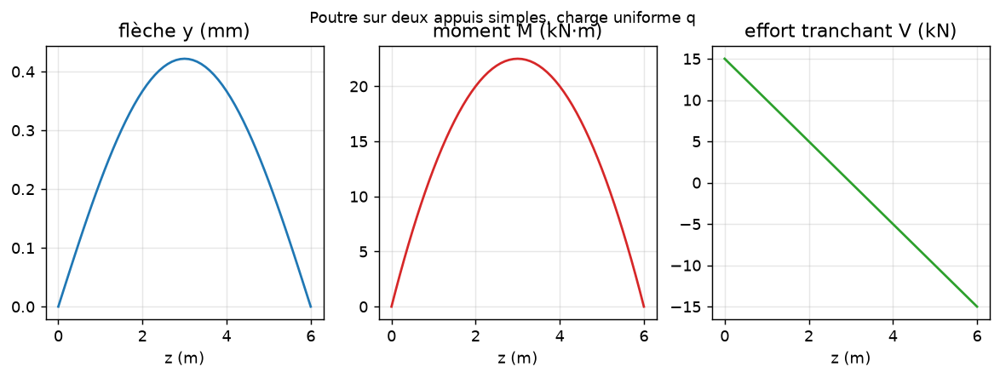

### Poutre sur deux appuis, force P au milieu

Identifiant : `biappuyee_ponctuelle_centre` — conforme (écart max 1.8e-10)

| Grandeur | Attendu | Calculé | Écart | Tolérance | Verdict | Source |
|---|---|---|---|---|---|---|
| flèche au milieu | 0,000225 m | 0,000225 m | 1.5e-10 | 1e-09 | conforme | PL³/48EI, formulaire de RDM (Timoshenko, Résistance des matériaux ; Roark 7e éd., tableau 8.1) |
| moment au milieu | 15 kN·m | 15 kN·m | 1.8e-10 | 1e-09 | conforme | PL/4 |
| réactions | 5 kN | 5 kN | 1.8e-10 | 1e-09 | conforme | P/2 |
| saut de V au droit de P | 10 kN | 10 kN | 0.0e+00 | 1e-09 | conforme | ΔV = P |
| équilibre des forces (résidu relatif) | 0 | 8,922e-11 | 8.9e-11 (abs.) | 1e-09 | conforme | statique |
| équilibre des moments (résidu relatif) | 0 | 4,511e-11 | 4.5e-11 (abs.) | 1e-09 | conforme | statique |
| V = dM/dz (écart relatif max) | 0 | 4,974e-15 | 5.0e-15 (abs.) | 1e-09 | conforme | RDM |
| q = dV/dz (écart relatif max) | 0 | 0 | 0.0e+00 (abs.) | 1e-09 | conforme | RDM |

### Poutre sur deux appuis, force P en z = a = L/3

Identifiant : `biappuyee_ponctuelle_excentree` — conforme (écart max 1.7e-10)

| Grandeur | Attendu | Calculé | Écart | Tolérance | Verdict | Source |
|---|---|---|---|---|---|---|
| moment sous la charge | 13,33 kN·m | 13,33 kN·m | 1.7e-10 | 1e-09 | conforme | Pab/L, formulaire de RDM (Timoshenko, Résistance des matériaux ; Roark 7e éd., tableau 8.1) |
| réaction en z = 0 | 6,667 kN | 6,667 kN | 1.0e-10 | 1e-09 | conforme | Pb/L |
| réaction en z = L | 3,333 kN | 3,333 kN | 1.7e-10 | 1e-09 | conforme | Pa/L |
| flèche sous la charge | 0,0001778 m | 0,0001778 m | 1.3e-10 | 1e-09 | conforme | Pa²b²/3EIL |
| équilibre des forces (résidu relatif) | 0 | 6,185e-11 | 6.2e-11 (abs.) | 1e-09 | conforme | statique |
| équilibre des moments (résidu relatif) | 0 | 2,789e-11 | 2.8e-11 (abs.) | 1e-09 | conforme | statique |
| V = dM/dz (écart relatif max) | 0 | 3,531e-15 | 3.5e-15 (abs.) | 1e-09 | conforme | RDM |
| q = dV/dz (écart relatif max) | 0 | 0 | 0.0e+00 (abs.) | 1e-09 | conforme | RDM |

### Poutre sur deux appuis, charge triangulaire (hydrostatique) de 0 à q0

Identifiant : `biappuyee_triangulaire` — conforme (écart max 1.2e-03)

| Grandeur | Attendu | Calculé | Écart | Tolérance | Verdict | Source |
|---|---|---|---|---|---|---|
| réaction côté charge nulle (z = 0) | 5 kN | 5 kN | 5.6e-06 | 1e-04 | conforme | q0·L/6, formulaire de RDM (Timoshenko, Résistance des matériaux ; Roark 7e éd., tableau 8.1) |
| réaction côté charge maximale (z = L) | 10 kN | 10 kN | 2.8e-06 | 1e-04 | conforme | q0·L/3 |
| moment maximal | 11,55 kN·m | 11,55 kN·m | 2.1e-06 | 1e-04 | conforme | q0·L²/(9√3) en z = L/√3 |
| position du moment maximal | 3,464 m | 3,46 m | 0.12 % | 1 % | conforme | L/√3 |
| équilibre des forces (résidu relatif) | 0 | -2,041e-10 | 2.0e-10 (abs.) | 1e-09 | conforme | statique |
| équilibre des moments (résidu relatif) | 0 | 2,522e-10 | 2.5e-10 (abs.) | 1e-09 | conforme | statique |
| V = dM/dz (écart relatif max) | 0 | 1,791e-13 | 1.8e-13 (abs.) | 1e-09 | conforme | RDM |
| q = dV/dz (écart relatif max) | 0 | 2,838e-14 | 2.8e-14 (abs.) | 1e-09 | conforme | RDM |

### Poutre encastrée aux deux extrémités, charge uniforme q

Identifiant : `biencastree_repartie` — conforme (écart max 8.0e-11)

| Grandeur | Attendu | Calculé | Écart | Tolérance | Verdict | Source |
|---|---|---|---|---|---|---|
| moment aux encastrements | -15 kN·m | -15 kN·m | 8.0e-11 | 1e-09 | conforme | −qL²/12, formulaire de RDM (Timoshenko, Résistance des matériaux ; Roark 7e éd., tableau 8.1) |
| moment au milieu | 7,5 kN·m | 7,5 kN·m | 5.5e-11 | 1e-09 | conforme | qL²/24 |
| flèche au milieu | 8,438e-05 m | 8,437e-05 m | 3.1e-11 | 1e-09 | conforme | qL⁴/384EI |
| réactions | 15 kN | 15 kN | 2.3e-11 | 1e-09 | conforme | qL/2 |
| équilibre des forces (résidu relatif) | 0 | 1,013e-11 | 1.0e-11 (abs.) | 1e-09 | conforme | statique |
| équilibre des moments (résidu relatif) | 0 | 4,577e-12 | 4.6e-12 (abs.) | 1e-09 | conforme | statique |
| V = dM/dz (écart relatif max) | 0 | 7,816e-15 | 7.8e-15 (abs.) | 1e-09 | conforme | RDM |
| q = dV/dz (écart relatif max) | 0 | 3,553e-15 | 3.6e-15 (abs.) | 1e-09 | conforme | RDM |

### Poutre encastrée en z = 0 et appuyée en z = L, charge uniforme q

Identifiant : `encastree_appuyee_repartie` — conforme (écart max 4.8e-11)

| Grandeur | Attendu | Calculé | Écart | Tolérance | Verdict | Source |
|---|---|---|---|---|---|---|
| réaction à l'appui simple | 11,25 kN | 11,25 kN | 1.6e-11 | 1e-09 | conforme | 3qL/8, formulaire de RDM (Timoshenko, Résistance des matériaux ; Roark 7e éd., tableau 8.1) |
| réaction à l'encastrement | 18,75 kN | 18,75 kN | 3.9e-11 | 1e-09 | conforme | 5qL/8 |
| moment à l'encastrement | -22,5 kN·m | -22,5 kN·m | 4.8e-11 | 1e-09 | conforme | −qL²/8 |
| moment positif maximal | 12,66 kN·m | 12,66 kN·m | 3.2e-11 | 1e-09 | conforme | 9qL²/128 en z = 5L/8 |
| équilibre des forces (résidu relatif) | 0 | -9,33e-12 | 9.3e-12 (abs.) | 1e-09 | conforme | statique |
| équilibre des moments (résidu relatif) | 0 | -9,3e-14 | 9.3e-14 (abs.) | 1e-09 | conforme | statique |
| V = dM/dz (écart relatif max) | 0 | 1,431e-14 | 1.4e-14 (abs.) | 1e-09 | conforme | RDM |
| q = dV/dz (écart relatif max) | 0 | 9,948e-15 | 9.9e-15 (abs.) | 1e-09 | conforme | RDM |

### Poutre continue sur trois appuis (deux travées égales L), charge uniforme q

Identifiant : `continue_2_travees` — conforme (écart max 1.5e-10)

| Grandeur | Attendu | Calculé | Écart | Tolérance | Verdict | Source |
|---|---|---|---|---|---|---|
| réaction d'extrémité | 11,25 kN | 11,25 kN | 1.3e-11 | 1e-09 | conforme | 3qL/8 (trois moments), formulaire de RDM (Timoshenko, Résistance des matériaux ; Roark 7e éd., tableau 8.1) |
| réaction centrale | 37,5 kN | 37,5 kN | 9.2e-12 | 1e-09 | conforme | 10qL/8 |
| réaction d'extrémité (z = 2L) | 11,25 kN | 11,25 kN | 5.4e-12 | 1e-09 | conforme | 3qL/8 |
| moment sur l'appui central | -22,5 kN·m | -22,5 kN·m | 1.6e-11 | 1e-09 | conforme | −qL²/8 |
| moment positif maximal en travée | 12,66 kN·m | 12,66 kN·m | 1.5e-10 | 1e-09 | conforme | 9qL²/128 en 3L/8 |
| équilibre des forces (résidu relatif) | 0 | -4,602e-12 | 4.6e-12 (abs.) | 1e-09 | conforme | statique |
| équilibre des moments (résidu relatif) | 0 | -1,945e-12 | 1.9e-12 (abs.) | 1e-09 | conforme | statique |
| V = dM/dz (écart relatif max) | 0 | 7,761e-14 | 7.8e-14 (abs.) | 1e-09 | conforme | RDM |
| q = dV/dz (écart relatif max) | 0 | 2,771e-14 | 2.8e-14 (abs.) | 1e-09 | conforme | RDM |

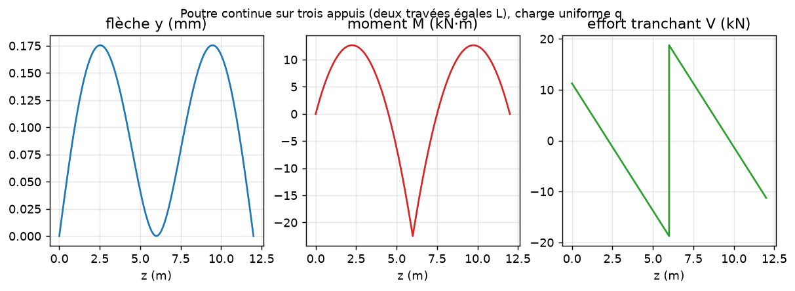

### Poutre continue sur quatre appuis (trois travées égales L), charge uniforme q

Identifiant : `continue_3_travees` — conforme (écart max 3.0e-10)

| Grandeur | Attendu | Calculé | Écart | Tolérance | Verdict | Source |
|---|---|---|---|---|---|---|
| réaction d'extrémité | 12 kN | 12 kN | 5.4e-11 | 1e-09 | conforme | 0,4·qL (trois moments), formulaire de RDM (Timoshenko, Résistance des matériaux ; Roark 7e éd., tableau 8.1) |
| réaction intermédiaire | 33 kN | 33 kN | 2.8e-11 | 1e-09 | conforme | 1,1·qL |
| moment sur appui intermédiaire | -18 kN·m | -18 kN·m | 3.0e-10 | 1e-09 | conforme | −qL²/10 |
| moment sur le second appui intermédiaire | -18 kN·m | -18 kN·m | 1.8e-10 | 1e-09 | conforme | −qL²/10 |
| moment positif maximal (travée de rive) | 14,4 kN·m | 14,4 kN·m | 9.1e-11 | 1e-09 | conforme | 0,08·qL² en 0,4L |
| équilibre des forces (résidu relatif) | 0 | 1,06e-11 | 1.1e-11 (abs.) | 1e-09 | conforme | statique |
| équilibre des moments (résidu relatif) | 0 | 3,995e-12 | 4.0e-12 (abs.) | 1e-09 | conforme | statique |
| V = dM/dz (écart relatif max) | 0 | 2,13e-13 | 2.1e-13 (abs.) | 1e-09 | conforme | RDM |
| q = dV/dz (écart relatif max) | 0 | 2,753e-14 | 2.8e-14 (abs.) | 1e-09 | conforme | RDM |

### Console encastrée en z = 0, ressort k en bout, force P en bout

Identifiant : `console_ressort_bout` — conforme (écart max 2.0e-10)

| Grandeur | Attendu | Calculé | Écart | Tolérance | Verdict | Source |
|---|---|---|---|---|---|---|
| flèche en bout | 0,0018 m | 0,0018 m | 1.2e-10 | 1e-09 | conforme | P/(k + 3EI/L³) : raideurs en parallèle |
| effort dans le ressort | 5 kN | 5 kN | 1.2e-10 | 1e-09 | conforme | k·y = P/2 |
| moment à l'encastrement | -30 kN·m | -30 kN·m | 1.2e-10 | 1e-09 | conforme | −(P − k·y)·L |
| équilibre des forces (résidu relatif) | 0 | 2,033e-10 | 2.0e-10 (abs.) | 1e-09 | conforme | statique |
| équilibre des moments (résidu relatif) | 0 | 9,914e-11 | 9.9e-11 (abs.) | 1e-09 | conforme | statique |
| V = dM/dz (écart relatif max) | 0 | 6,573e-15 | 6.6e-15 (abs.) | 1e-09 | conforme | RDM |
| q = dV/dz (écart relatif max) | 0 | 0 | 0.0e+00 (abs.) | 1e-09 | conforme | RDM |

### Poutre sur deux appuis (portée 2a), ressort k au milieu, charge uniforme q

Identifiant : `biappuyee_ressort_central` — conforme (écart max 4.4e-08)

| Grandeur | Attendu | Calculé | Écart | Tolérance | Verdict | Source |
|---|---|---|---|---|---|---|
| effort dans le ressort | 5,819 kN | 5,819 kN | 1.0e-10 | 1e-07 | conforme | δ₀/(1/k + L³/48EI), δ₀ = 5qL⁴/384EI (compatibilité ; 1e-7 : conditionnement) |
| flèche au milieu | 0,0002909 m | 0,0002909 m | 1.0e-10 | 1e-07 | conforme | R_c/k |
| limite ressort infiniment raide = appui central | 18,75 kN | 18,75 kN | 4.4e-08 | 1e-06 | conforme | 10·q·a/8 (poutre continue à deux travées a) |
| équilibre des forces (résidu relatif) | 0 | 3,878e-11 | 3.9e-11 (abs.) | 1e-09 | conforme | statique |
| équilibre des moments (résidu relatif) | 0 | 1,642e-11 | 1.6e-11 (abs.) | 1e-09 | conforme | statique |
| V = dM/dz (écart relatif max) | 0 | 3,012e-14 | 3.0e-14 (abs.) | 1e-09 | conforme | RDM |
| q = dV/dz (écart relatif max) | 0 | 3,553e-15 | 3.6e-15 (abs.) | 1e-09 | conforme | RDM |

### Poutre sur deux appuis, couple C appliqué au milieu

Identifiant : `couple_milieu` — conforme (écart max 2.9e-11)

| Grandeur | Attendu | Calculé | Écart | Tolérance | Verdict | Source |
|---|---|---|---|---|---|---|
| saut de M au droit du couple | 12 kN·m | 12 kN·m | 0.0e+00 | 1e-09 | conforme | ΔM = C, formulaire de RDM (Timoshenko, Résistance des matériaux ; Roark 7e éd., tableau 8.1) |
| effort tranchant (constant) | 2 kN | 2 kN | 8.8e-12 | 1e-09 | conforme | |V| = C/L |
| réactions opposées | 2 kN | 2 kN | 1.8e-11 | 1e-09 | conforme | |R| = C/L |
| flèche au milieu (antisymétrie) | 0 m | 5,051e-16 m | 2.9e-11 (abs.) | 1e-09 | conforme | 0 |
| rotation aux appuis | 1,5e-05 rad | 1,5e-05 rad | 2.7e-11 | 1e-09 | conforme | C·L/24EI |
| rotation sous le couple | 3e-05 rad | 3e-05 rad | 5.7e-12 | 1e-09 | conforme | C·L/12EI |
| moment nul aux appuis | 0 kN·m | 1,05e-10 kN·m | 8.8e-12 (abs.) | 1e-09 | conforme | appuis simples |
| équilibre des forces (résidu relatif) | 0 | -4,775e-12 | 4.8e-12 (abs.) | 1e-09 | conforme | statique |
| équilibre des moments (résidu relatif) | 0 | 4,377e-12 | 4.4e-12 (abs.) | 1e-09 | conforme | statique |
| V = dM/dz (écart relatif max) | 0 | 7,438e-15 | 7.4e-15 (abs.) | 1e-09 | conforme | RDM |
| q = dV/dz (écart relatif max) | 0 | 0 | 0.0e+00 (abs.) | 1e-09 | conforme | RDM |

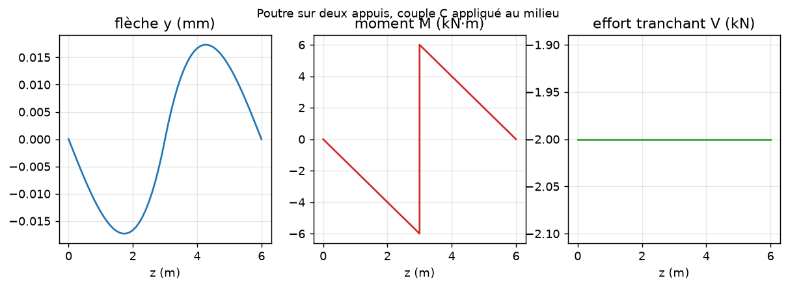

## Poutres sur fondation de Winkler (Hetényi)

### Poutre semi-infinie sur fondation de Winkler, force P à l'extrémité libre

Identifiant : `winkler_semi_infinie_force` — conforme (écart max 5.0e-04)

| Grandeur | Attendu | Calculé | Écart | Tolérance | Verdict | Source |
|---|---|---|---|---|---|---|
| flèche sous la force | 0,004729 m | 0,004728 m | 0.02 % | 1 % | conforme | y₀ = 2Pλ/k, λ = (k/4EI)^¼, Hetényi M. (1946), Beams on Elastic Foundation, chap. II |
| moment maximal (en z = π/4λ) | -6,818 kN·m | -6,814 kN·m | 0.05 % | 1 % | conforme | −0,3224·P/λ : M = −(P/λ)·e^(−λz)·sin λz |
| moment nul à l'extrémité libre | 0 kN·m | 0,00591 kN·m | 2.8e-04 (abs.) | 1e-03 | conforme | extrémité libre (réaction du sol répartie sur la demi-bande d'extrémité : écart en (λh)²) |
| équilibre des forces (résidu relatif) | 0 | -1,479e-10 | 1.5e-10 (abs.) | 1e-09 | conforme | statique |
| équilibre des moments (résidu relatif) | 0 | -4,079e-12 | 4.1e-12 (abs.) | 1e-09 | conforme | statique |
| V = dM/dz (écart relatif max) | 0 | 1,767e-14 | 1.8e-14 (abs.) | 1e-09 | conforme | RDM |
| q = dV/dz (écart relatif max) | 0 | 1,103e-14 | 1.1e-14 (abs.) | 1e-09 | conforme | RDM |
| V nul à l'extrémité libre z = L | 0 kN | 0 kN | 0.0e+00 (abs.) | 1e-08 | conforme | statique |

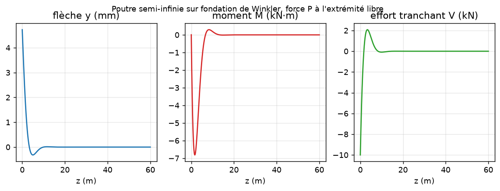

### Poutre semi-infinie sur fondation de Winkler, couple C à l'extrémité libre

Identifiant : `winkler_semi_infinie_couple` — conforme (écart max 2.8e-04)

| Grandeur | Attendu | Calculé | Écart | Tolérance | Verdict | Source |
|---|---|---|---|---|---|---|
| flèche à l'extrémité (valeur absolue) | 0,002683 m | 0,002683 m | 0.03 % | 1 % | conforme | |y₀| = 2Cλ²/k, Hetényi M. (1946), Beams on Elastic Foundation, chap. II |
| moment à l'extrémité (valeur absolue) | 12 kN·m | 12 kN·m | 0.03 % | 1e-03 | conforme | |M(0)| = C (écart en (λh)², réaction répartie sur la demi-bande d'extrémité) |
| équilibre des forces (résidu relatif) | 0 | -2,264e-10 | 2.3e-10 (abs.) | 1e-09 | conforme | statique |
| équilibre des moments (résidu relatif) | 0 | -1,188e-11 | 1.2e-11 (abs.) | 1e-09 | conforme | statique |
| V = dM/dz (écart relatif max) | 0 | 8,231e-14 | 8.2e-14 (abs.) | 1e-09 | conforme | RDM |
| q = dV/dz (écart relatif max) | 0 | 4,831e-15 | 4.8e-15 (abs.) | 1e-09 | conforme | RDM |
| V nul à l'extrémité libre z = L | 0 kN | 0 kN | 0.0e+00 (abs.) | 1e-08 | conforme | statique |

### Poutre infinie sur fondation de Winkler, force P au milieu

Identifiant : `winkler_infinie_force` — conforme (écart max 1.9e-04)

| Grandeur | Attendu | Calculé | Écart | Tolérance | Verdict | Source |
|---|---|---|---|---|---|---|
| flèche sous la force | 0,001182 m | 0,001182 m | 1.5e-09 | 1 % | conforme | y₀ = Pλ/2k, Hetényi M. (1946), Beams on Elastic Foundation, chap. II |
| moment sous la force | 5,287 kN·m | 5,288 kN·m | 0.02 % | 1 % | conforme | M₀ = +P/4λ (face chargée tendue sous la force) |
| équilibre des forces (résidu relatif) | 0 | -4,384e-10 | 4.4e-10 (abs.) | 1e-09 | conforme | statique |
| équilibre des moments (résidu relatif) | 0 | -2,191e-10 | 2.2e-10 (abs.) | 1e-09 | conforme | statique |
| V = dM/dz (écart relatif max) | 0 | 3,4e-12 | 3.4e-12 (abs.) | 1e-09 | conforme | RDM |
| q = dV/dz (écart relatif max) | 0 | 1,068e-13 | 1.1e-13 (abs.) | 1e-09 | conforme | RDM |
| V nul à l'extrémité libre z = 0 | 0 kN | -9,383e-09 kN | 4.4e-10 (abs.) | 1e-08 | conforme | statique |
| V nul à l'extrémité libre z = L | 0 kN | 0 kN | 0.0e+00 (abs.) | 1e-08 | conforme | statique |

### Poutre sur fondation de Winkler, charge uniforme q : tassement uniforme sans flexion (charges nodales concentrées, comme le moteur : avec les charges cohérentes, le couple qL²/12 des éléments d'extrémité crée une couche limite de 1e-7 relatif)

Identifiant : `winkler_uniforme` — conforme (écart max 3.1e-09)

| Grandeur | Attendu | Calculé | Écart | Tolérance | Verdict | Source |
|---|---|---|---|---|---|---|
| flèche uniforme | 0,0025 m | 0,0025 m | 6.0e-10 | 1e-09 | conforme | y = q/k |
| flèche uniforme (écart max) | 0 m | 2,366e-12 m | 9.5e-10 (abs.) | 1e-09 | conforme | y = q/k partout |
| moment nul | 0 kN·m | 6,997e-06 kN·m | 3.1e-09 (abs.) | 1e-08 | conforme | M = 0 (arrondi sur 1 200 éléments) |
| équilibre des forces (résidu relatif) | 0 | -2,985e-10 | 3.0e-10 (abs.) | 1e-09 | conforme | statique |
| équilibre des moments (résidu relatif) | 0 | -1,944e-10 | 1.9e-10 (abs.) | 1e-09 | conforme | statique |
| V = dM/dz (écart relatif max) | 0 | 4,8e-13 | 4.8e-13 (abs.) | 1e-09 | conforme | RDM |
| q = dV/dz (écart relatif max) | 0 | 1,794e-13 | 1.8e-13 (abs.) | 1e-09 | conforme | RDM |
| V nul à l'extrémité libre z = 0 | 0 kN | -1,791e-07 kN | 3.0e-10 (abs.) | 1e-08 | conforme | statique |
| V nul à l'extrémité libre z = L | 0 kN | 0 kN | 0.0e+00 (abs.) | 1e-08 | conforme | statique |

## Plaque sans sol (grillage pseudo-3D contre Timoshenko)

### Plaque carrée 4 × 4 m appuyée sur quatre côtés, charge uniforme (ν = 0), maillage 20 × 20

Identifiant : `plaque_carree_appuyee` — conforme (écart max 3.9e-03)

| Grandeur | Attendu | Calculé | Écart | Tolérance | Verdict | Source |
|---|---|---|---|---|---|---|
| w au centre | 0,0104 m | 0,01038 m | 0.17 % | 1 % | conforme | série de Navier, Timoshenko & Woinowsky-Krieger (1959), Theory of Plates and Shells, 2e éd. § 30 (0,00406·q·a⁴/D) |
| Ms (= Mx) au centre | 5,894 kN·m/m | 5,917 kN·m/m | 0.39 % | 2 % | conforme | série de Navier dérivée, ν = 0 |
| Mz (= My) au centre | 5,894 kN·m/m | 5,917 kN·m/m | 0.39 % | 2 % | conforme | série de Navier dérivée, ν = 0 |
| Σ réactions = charge totale | 160 kN | 160 kN | 2.2e-13 | 1e-10 | conforme | statique |

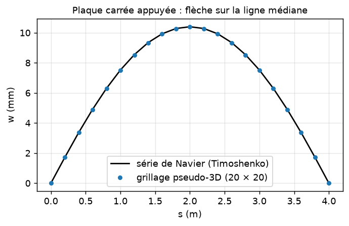

### Plaque 8 × 4 m appuyée, charge uniforme : centre et point (a/4, b/4)

Identifiant : `plaque_rectangulaire_appuyee` — conforme (écart max 3.2e-03)

| Grandeur | Attendu | Calculé | Écart | Tolérance | Verdict | Source |
|---|---|---|---|---|---|---|
| w au centre | 0,02593 m | 0,02589 m | 0.16 % | 1 % | conforme | Timoshenko & Woinowsky-Krieger (1959), Theory of Plates and Shells, 2e éd. § 30 |
| Ms au centre | 2,786 kN·m/m | 2,791 kN·m/m | 0.19 % | 2 % | conforme | Timoshenko & Woinowsky-Krieger (1959), Theory of Plates and Shells, 2e éd. § 30 |
| Mz au centre | 15,43 kN·m/m | 15,45 kN·m/m | 0.11 % | 2 % | conforme | Timoshenko & Woinowsky-Krieger (1959), Theory of Plates and Shells, 2e éd. § 30 |
| w au point (a/4, b/4) | 0,0143 m | 0,01427 m | 0.19 % | 1 % | conforme | Timoshenko & Woinowsky-Krieger (1959), Theory of Plates and Shells, 2e éd. § 30 |
| Ms au point (a/4, b/4) | 2,68 kN·m/m | 2,688 kN·m/m | 0.32 % | 2 % | conforme | Timoshenko & Woinowsky-Krieger (1959), Theory of Plates and Shells, 2e éd. § 30 |
| Mz au point (a/4, b/4) | 9,156 kN·m/m | 9,17 kN·m/m | 0.15 % | 2 % | conforme | Timoshenko & Woinowsky-Krieger (1959), Theory of Plates and Shells, 2e éd. § 30 |

### Plaque carrée appuyée, force de 100 kN au centre

Identifiant : `plaque_charge_ponctuelle` — conforme (écart max 2.8e-03)

| Grandeur | Attendu | Calculé | Écart | Tolérance | Verdict | Source |
|---|---|---|---|---|---|---|
| w au centre | 0,01856 m | 0,01861 m | 0.28 % | 1 % | conforme | Timoshenko & Woinowsky-Krieger (1959), Theory of Plates and Shells, 2e éd. § 33 |
| w en (a/4, b/2) | 0,01142 m | 0,01144 m | 0.17 % | 1 % | conforme | Timoshenko & Woinowsky-Krieger (1959), Theory of Plates and Shells, 2e éd. § 33 |
| Σ réactions = P | 100 kN | 100 kN | 6.7e-13 | 1e-10 | conforme | statique |

### Plaque carrée appuyée, Ds = Dz/10 (orthotrope de Huber, torsion √(Ds·Dz))

Identifiant : `plaque_orthotrope` — conforme (écart max 1.1e-02)

| Grandeur | Attendu | Calculé | Écart | Tolérance | Verdict | Source |
|---|---|---|---|---|---|---|
| w au centre | 0,02359 m | 0,02356 m | 0.16 % | 1 % | conforme | Timoshenko & Woinowsky-Krieger (1959), Theory of Plates and Shells, 2e éd. § 91 (H = √(Dx·Dy)) |
| Ms au centre | 1,103 kN·m/m | 1,116 kN·m/m | 1.14 % | 3 % | conforme | Timoshenko & Woinowsky-Krieger (1959), Theory of Plates and Shells, 2e éd. § 91 |
| Mz au centre | 13,99 kN·m/m | 14,01 kN·m/m | 0.14 % | 3 % | conforme | Timoshenko & Woinowsky-Krieger (1959), Theory of Plates and Shells, 2e éd. § 91 |

### Plaque carrée encastrée sur quatre côtés, charge uniforme

Identifiant : `plaque_encastree` — conforme (écart max 6.6e-03)

| Grandeur | Attendu | Calculé | Écart | Tolérance | Verdict | Source |
|---|---|---|---|---|---|---|
| w au centre | 0,003226 m | 0,003247 m | 0.66 % | 3 % | conforme | Timoshenko & Woinowsky-Krieger (1959), Theory of Plates and Shells, 2e éd. § 44, table 35 (0,00126·q·a⁴/D) |

### Bande appuyée sur deux bords opposés, libre sur les autres : poutre dans chaque direction

Identifiant : `plaque_flexion_cylindrique` — conforme (écart max 2.5e-12)

| Grandeur | Attendu | Calculé | Écart | Tolérance | Verdict | Source |
|---|---|---|---|---|---|---|
| w milieu (appuis en z) | 0,03327 m | 0,03327 m | 4.6e-14 | 1e-09 | conforme | poutre à charges nodales : 5qL⁴/384D·(1 − 4/5n²) |
| Mz milieu (appuis en z) | 20 kN·m/m | 20 kN·m/m | 4.6e-13 | 1e-06 | conforme | qL²/8 |
| Ms ≡ 0 (appuis en z) | 0 kN·m/m | 4,735e-11 kN·m/m | 2.4e-12 (abs.) | 1e-09 | conforme | flexion cylindrique |
| w milieu (appuis en s, Ds = 400) | 0,08317 m | 0,08317 m | 1.1e-12 | 1e-09 | conforme | poutres horizontales seules |
| Ms milieu (appuis en s) | 20 kN·m/m | 20 kN·m/m | 8.5e-13 | 1e-06 | conforme | qa²/8 |
| Mz ≡ 0 (appuis en s) | 0 kN·m/m | 4,986e-11 kN·m/m | 2.5e-12 (abs.) | 1e-09 | conforme | flexion cylindrique |

### Plaque 6 × 4 m (Dz 1000, Ds 300) et la même tournée de 90° : champ transposé

Identifiant : `plaque_isotropie` — conforme (écart max 5.4e-13)

| Grandeur | Attendu | Calculé | Écart | Tolérance | Verdict | Source |
|---|---|---|---|---|---|---|
| écart max de w après rotation | 0 m | 2,522e-15 m | 9.7e-14 (abs.) | 1e-08 | conforme | symétrie du grillage |
| écart max Mz <-> Ms après rotation | 0 kN·m/m | 8,446e-12 kN·m/m | 5.4e-13 (abs.) | 1e-08 | conforme | symétrie du grillage |

### Plaque carrée appuyée : erreur sur w au centre pour 10, 20, 40 éléments par côté

Identifiant : `plaque_convergence` — conforme (écart max 8.0e-04)

| Grandeur | Attendu | Calculé | Écart | Tolérance | Verdict | Source |
|---|---|---|---|---|---|---|
| erreur relative à 40 éléments | 0 | 0,0004369 | 4.4e-04 (abs.) | 2e-03 | conforme | O(h²) |
| rapport des erreurs 10/20 (≈ 4 en O(h²)) | 4 | 3,997 | 0.08 % | 5 % | conforme | ordre 2 du grillage |
| rapport des erreurs 20/40 (≈ 4 en O(h²)) | 4 | 3,999 | 0.03 % | 5 % | conforme | ordre 2 du grillage |

## Écran 2D : équilibre limite, équilibre par phase, convergence

### Écran autostable très raide (EI 1e9) dans un sable φ = 30° : hauteur critique d'excavation

Identifiant : `ecran_autostable_rigide` — conforme (écart max 3.0e-06)

| Grandeur | Attendu | Calculé | Écart | Tolérance | Verdict | Source |
|---|---|---|---|---|---|---|
| hauteur critique | 5,047 m | 5,047 m | 3.0e-06 | 2 % | conforme | équilibre limite rigide-plastique (Ka = 1/3, Kp = 3) |

### Écran rigide de 12 m ancré en tête (ancrage très raide) dans un sable φ = 30° : hauteur critique et effort d'ancrage de la butée simple

Identifiant : `ecran_ancre_butee_simple` — conforme (écart max 5.9e-03)

| Grandeur | Attendu | Calculé | Écart | Tolérance | Verdict | Source |
|---|---|---|---|---|---|---|
| hauteur critique d'excavation | 8,566 m | 8,566 m | 1.4e-05 | 2 % | conforme | butée simple (free earth support), Ka = 1/3, Kp = 3 |
| effort d'ancrage à la limite | 126,3 kN/m | 125,5 kN/m | 0.59 % | 5 % | conforme | T = Pa − Pp = Ka·γ·D²/2 − Kp·γ·(D − h)²/2 |

### Écran butonné avec nappe : somme des forces (sol, eau, appui) nulle à chaque phase

Identifiant : `ecran_equilibre_phases` — conforme (écart max 1.8e-11)

| Grandeur | Attendu | Calculé | Écart | Tolérance | Verdict | Source |
|---|---|---|---|---|---|---|
| résidu relatif des forces — État initial | 0 | 0 | 0.0e+00 (abs.) | 1e-06 | conforme | statique |
| résidu relatif des forces — Exc1 | 0 | 2,375e-12 | 2.4e-12 (abs.) | 1e-06 | conforme | statique |
| résidu relatif des forces — Pose | 0 | 2,375e-12 | 2.4e-12 (abs.) | 1e-06 | conforme | statique |
| résidu relatif des forces — Exc2 | 0 | 1,771e-11 | 1.8e-11 (abs.) | 1e-06 | conforme | statique |
| pressions toujours entre poussée et butée limites | oui | oui | — | — | conforme | loi des ressorts |

### Écran butonné : pas du maillage 0,5, 0,2, 0,1, 0,05 m

Identifiant : `ecran_convergence_maillage` — conforme (écart max 5.9e-04)

| Grandeur | Attendu | Calculé | Écart | Tolérance | Verdict | Source |
|---|---|---|---|---|---|---|
| y_max au pas 0,1 contre 0,05 | 9,961 mm | 9,959 mm | 0.02 % | 1 % | conforme | convergence |
| M_max au pas 0,1 contre 0,05 | 118,1 kN·m/m | 118,1 kN·m/m | 0.04 % | 1 % | conforme | convergence |
| effort d'appui au pas 0,1 contre 0,05 | 64,56 kN/m | 64,59 kN/m | 0.06 % | 1 % | conforme | convergence |

Résultats du balayage :

| pas (m) | y_max_mm | y_vers_fouille_mm | M_max | M_min | V_absmax | effort_appui |
|---|---|---|---|---|---|---|
| 0,5 | 9,883 | 9,883 | 117,6 | -58,94 | 70,36 | 64,64 |
| 0,2 | 9,949 | 9,949 | 117,9 | -59,66 | 71,95 | 64,86 |
| 0,1 | 9,959 | 9,959 | 118,1 | -59,76 | 71,97 | 64,59 |
| 0,05 | 9,961 | 9,961 | 118,1 | -59,75 | 72,04 | 64,56 |

## Écran 2D : balayages de grandeurs physiques

### Coefficient de réaction kh de 10 000 à 80 000 kN/m³

Identifiant : `balayage_kh` — conforme (écart max 0.0e+00)

| Grandeur | Attendu | Calculé | Écart | Tolérance | Verdict | Source |
|---|---|---|---|---|---|---|
| y_max_mm décroît quand kh (kN/m³) croît | oui | oui | — | — | conforme | physique de l'écran |

Résultats du balayage :

| kh (kN/m³) | y_max_mm | y_vers_fouille_mm | M_max | M_min | V_absmax | effort_appui |
|---|---|---|---|---|---|---|
| 1e+04 | 12,8 | 12,8 | 128,8 | -42,42 | 68,76 | 68,09 |
| 2e+04 | 9,959 | 9,959 | 118,1 | -59,76 | 71,97 | 64,59 |
| 4e+04 | 8,328 | 8,328 | 111,5 | -71,73 | 74,04 | 62,2 |
| 8e+04 | 7,407 | 7,407 | 107,7 | -79,86 | 75,3 | 60,56 |

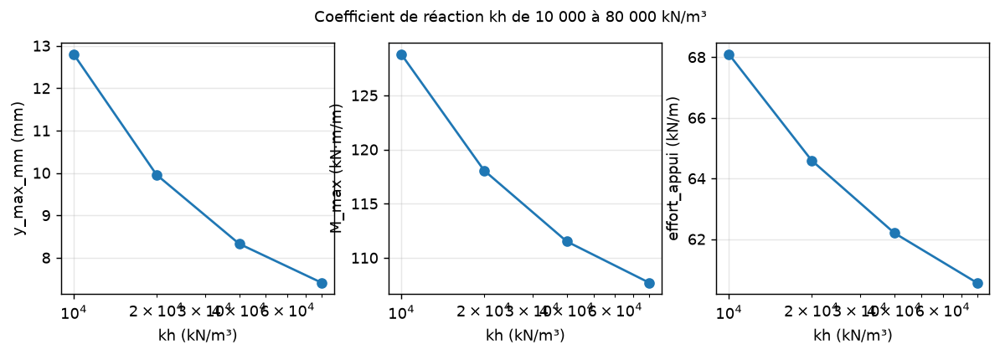

### Rigidité de l'écran de 1e4 (palplanches légères) à 1e6 kN·m²/m (paroi moulée)

Identifiant : `balayage_EI` — conforme (écart max 0.0e+00)

| Grandeur | Attendu | Calculé | Écart | Tolérance | Verdict | Source |
|---|---|---|---|---|---|---|
| y_max_mm décroît quand EI (kN·m²/m) croît | oui | oui | — | — | conforme | physique de l'écran |

Résultats du balayage :

| EI (kN·m²/m) | y_max_mm | y_vers_fouille_mm | M_max | M_min | V_absmax | effort_appui |
|---|---|---|---|---|---|---|
| 1e+04 | 57,25 | 57,25 | 103,9 | -78,74 | 74,13 | 80,07 |
| 1e+05 | 9,959 | 9,959 | 118,1 | -59,76 | 71,97 | 64,59 |
| 1e+06 | 4,019 | 4,019 | 155,3 | -11,5 | 69,82 | 73,15 |

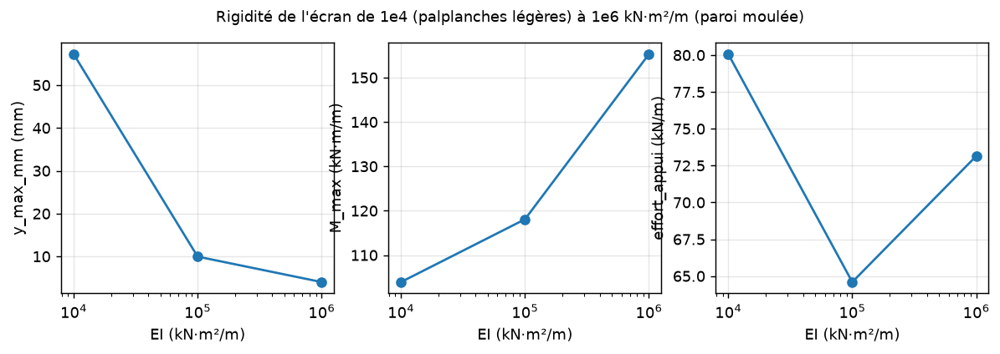

### Angle de frottement de 25 à 40°

Identifiant : `balayage_phi` — conforme (écart max 0.0e+00)

| Grandeur | Attendu | Calculé | Écart | Tolérance | Verdict | Source |
|---|---|---|---|---|---|---|
| y_max_mm décroît quand phi (°) croît | oui | oui | — | — | conforme | physique de l'écran |
| effort_appui décroît quand phi (°) croît | oui | oui | — | — | conforme | physique de l'écran |

Résultats du balayage :

| phi (°) | y_max_mm | y_vers_fouille_mm | M_max | M_min | V_absmax | effort_appui |
|---|---|---|---|---|---|---|
| 25 | 16,42 | 16,42 | 177,3 | -78,17 | 88,49 | 89,27 |
| 30 | 9,959 | 9,959 | 118,1 | -59,76 | 71,97 | 64,59 |
| 35 | 6,778 | 6,778 | 84,12 | -43,42 | 57,8 | 48,44 |
| 40 | 4,866 | 4,866 | 61,84 | -31,98 | 45,94 | 36,76 |

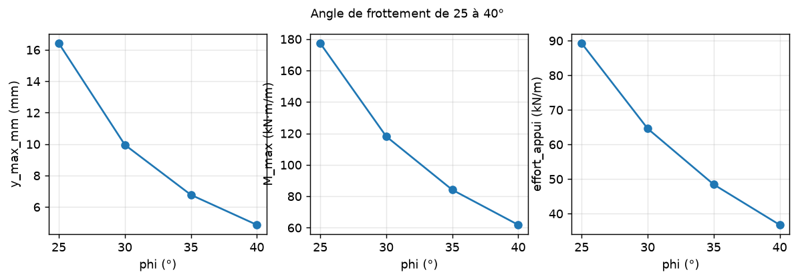

### Poids volumique de 17 à 21 kN/m³

Identifiant : `balayage_gamma` — conforme (écart max 0.0e+00)

| Grandeur | Attendu | Calculé | Écart | Tolérance | Verdict | Source |
|---|---|---|---|---|---|---|
| y_max_mm croît quand gamma (kN/m³) croît | oui | oui | — | — | conforme | physique de l'écran |
| M_max croît quand gamma (kN/m³) croît | oui | oui | — | — | conforme | physique de l'écran |
| effort_appui croît quand gamma (kN/m³) croît | oui | oui | — | — | conforme | physique de l'écran |

Résultats du balayage :

| gamma (kN/m³) | y_max_mm | y_vers_fouille_mm | M_max | M_min | V_absmax | effort_appui |
|---|---|---|---|---|---|---|
| 17 | 8,465 | 8,465 | 100,4 | -50,79 | 61,18 | 54,91 |
| 19 | 9,461 | 9,461 | 112,2 | -56,77 | 68,37 | 61,36 |
| 21 | 10,46 | 10,46 | 124 | -62,75 | 75,57 | 67,82 |

### Hauteur d'excavation finale de 4 à 7 m (fiche de 12 m)

Identifiant : `balayage_H` — conforme (écart max 0.0e+00)

| Grandeur | Attendu | Calculé | Écart | Tolérance | Verdict | Source |
|---|---|---|---|---|---|---|
| y_max_mm croît quand H (m) croît | oui | oui | — | — | conforme | physique de l'écran |
| M_max croît quand H (m) croît | oui | oui | — | — | conforme | physique de l'écran |
| effort_appui croît quand H (m) croît | oui | oui | — | — | conforme | physique de l'écran |

Résultats du balayage :

| H (m) | y_max_mm | y_vers_fouille_mm | M_max | M_min | V_absmax | effort_appui |
|---|---|---|---|---|---|---|
| 4 | 3,551 | 3,551 | 31,21 | -21,72 | 29,4 | 30,6 |
| 5 | 5,54 | 5,54 | 66,79 | -35,86 | 48,12 | 45,7 |
| 6 | 9,959 | 9,959 | 118,1 | -59,76 | 71,97 | 64,59 |
| 7 | 19,99 | 19,99 | 202,8 | -70,97 | 97,51 | 90,87 |

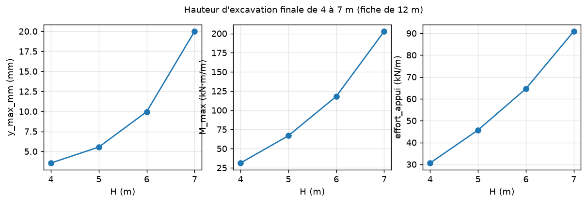

### Raideur du buton de 3 000 à 3 000 000 kN/m par mètre

Identifiant : `balayage_k_appui` — conforme (écart max 0.0e+00)

| Grandeur | Attendu | Calculé | Écart | Tolérance | Verdict | Source |
|---|---|---|---|---|---|---|
| effort_appui croît quand k_appui (kN/m/m) croît | oui | oui | — | — | conforme | physique de l'écran |
| y_max_mm décroît quand k_appui (kN/m/m) croît | oui | oui | — | — | conforme | physique de l'écran |

Résultats du balayage :

| k_appui (kN/m/m) | y_max_mm | y_vers_fouille_mm | M_max | M_min | V_absmax | effort_appui |
|---|---|---|---|---|---|---|
| 3000 | 21,46 | 21,46 | 98,23 | -103,8 | 78,54 | 56,39 |
| 3e+04 | 9,959 | 9,959 | 118,1 | -59,76 | 71,97 | 64,59 |
| 3e+05 | 8,927 | 8,927 | 118,4 | -53,72 | 70,33 | 77,41 |
| 3e+06 | 8,811 | 8,811 | 118,5 | -53,03 | 70,15 | 79,49 |

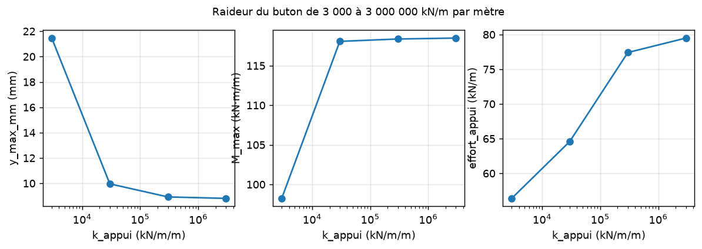

### Précharge du buton de 0 à 150 kN/m (le déplacement vers la fouille diminue ; |y| max peut croître quand l'écran est repoussé vers la terre au niveau du buton)

Identifiant : `balayage_precharge` — conforme (écart max 0.0e+00)

| Grandeur | Attendu | Calculé | Écart | Tolérance | Verdict | Source |
|---|---|---|---|---|---|---|
| y_vers_fouille_mm décroît quand precharge (kN/m) croît | oui | oui | — | — | conforme | physique de l'écran |
| effort après la pose seule = précharge (50 kN/m) | 50 kN/m | 50 kN/m | 0.0e+00 | 1e-06 | conforme | mise en charge au vérin (convention K-Réa) |
| effort après la pose seule = précharge (150 kN/m) | 150 kN/m | 150 kN/m | 0.0e+00 | 1e-06 | conforme | mise en charge au vérin (convention K-Réa) |

Résultats du balayage :

| precharge (kN/m) | y_max_mm | y_vers_fouille_mm | M_max | M_min | V_absmax | effort_appui |
|---|---|---|---|---|---|---|
| 0 | 9,959 | 9,959 | 118,1 | -59,76 | 71,97 | 64,59 |
| 50 | 8,748 | 8,748 | 118,6 | -52,65 | 70,05 | 80,85 |
| 100 | 7,777 | 7,777 | 123,3 | -46,62 | 79,97 | 109,5 |
| 150 | 7,895 | 7,182 | 139,1 | -42,69 | 116,6 | 146,6 |

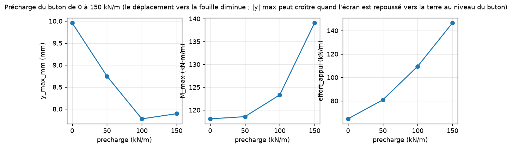

### Nappe amont absente, à −4 m, à −2 m (fouille pompée à −6 m)

Identifiant : `balayage_nappe` — conforme (écart max 0.0e+00)

| Grandeur | Attendu | Calculé | Écart | Tolérance | Verdict | Source |
|---|---|---|---|---|---|---|
| y_max_mm croît quand eau amont (m) croît | oui | oui | — | — | conforme | physique de l'écran |
| effort_appui croît quand eau amont (m) croît | oui | oui | — | — | conforme | physique de l'écran |

Résultats du balayage :

| eau amont (m) | y_max_mm | y_vers_fouille_mm | M_max | M_min | V_absmax | effort_appui |
|---|---|---|---|---|---|---|
| None | 9,959 | 9,959 | 118,1 | -59,76 | 71,97 | 64,59 |
| -4 | 27,81 | 27,81 | 260,2 | -32,85 | 97,23 | 107,1 |
| -2 | 48,74 | 48,74 | 419,8 | -6,546 | 142,8 | 155 |

## Pseudo-3D : coupes 2D assemblées contre vraie plaque, double écran

### Paroi droite 48 m, butons tous les 4 m, rapport Ds/Dz de 0 à 1 : des coupes 2D assemblées à la vraie plaque

Identifiant : `p3d_rigidite_horizontale` — conforme (écart max 3.3e-03)

| Grandeur | Attendu | Calculé | Écart | Tolérance | Verdict | Source |
|---|---|---|---|---|---|---|
| Ds = 0 : ligne sans buton = écran 2D sans appui | 0,1919 m | 0,1919 m | 1.2e-10 | 1e-06 | conforme | coupes 2D indépendantes |
| Ds = 0 : rapport max/min > 3 (chaque buton ne retient que sa ligne) | oui | oui | — | — | conforme | bandes indépendantes |
| Ds = Dz : rapport max/min < 1,3 (la plaque redistribue) | oui | oui | — | — | conforme | plaque isotrope |
| Ds = Dz : déplacement encadré par le 2D à appui réparti et la bande libre | oui | oui | — | — | conforme | encadrement physique |
| Ds = Dz : effort par buton / (H_2D · e) | 1 | 0,9967 | 0.33 % | 5 % | conforme | paroi longue ≈ 2D |
| le déplacement maximal décroît quand Ds/Dz croît | oui | oui | — | — | conforme | monotonie |

Résultats du balayage :

| Ds/Dz | y_max_mm | y_min_interieur_mm | rapport_max_min | Mz_max | Ms_absmax | effort_par_buton_kN | effort_sur_H2D_e |
|---|---|---|---|---|---|---|---|
| 0 | 191,9 | 5,148 | 37,27 | 95,34 | 0 | 92,77 | 0,3945 |
| 0,001 | 62,22 | 5,937 | 8,19 | 106,9 | 12,95 | 192,5 | 0,8185 |
| 0,01 | 17,38 | 6,484 | 1,633 | 110,3 | 23,75 | 219,4 | 0,9328 |
| 0,1 | 7,831 | 6,311 | 1,036 | 100,4 | 32,03 | 226,6 | 0,9634 |
| 1 | 6,466 | 6,179 | 1,004 | 95,73 | 51,61 | 234,4 | 0,9967 |

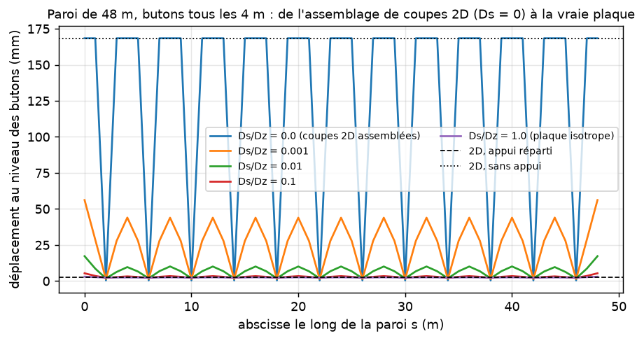

### Paroi isotrope 48 m : espacement des butons 2, 4, 6, 8 m (même raideur par buton)

Identifiant : `p3d_espacement` — conforme (écart max 8.2e-03)

| Grandeur | Attendu | Calculé | Écart | Tolérance | Verdict | Source |
|---|---|---|---|---|---|---|
| le déplacement entre butons croît avec l'espacement | oui | oui | — | — | conforme | monotonie |
| la variation le long de la paroi croît avec l'espacement | oui | oui | — | — | conforme | monotonie |
| effort par buton / (H_2D · e) à 4 m | 1 | 0,9918 | 0.82 % | 5 % | conforme | paroi longue ≈ 2D |

Résultats du balayage :

| espacement_m | y_max_mm | rapport_max_min | Ms_absmax | effort_par_buton_kN | effort_sur_H2D_e |
|---|---|---|---|---|---|
| 2 | 6,172 | 1,001 | 16,63 | 117,3 | 0,9973 |
| 4 | 6,203 | 1,004 | 51,61 | 233,2 | 0,9918 |
| 6 | 6,351 | 1,024 | 92,91 | 343,4 | 0,9733 |
| 8 | 6,786 | 1,08 | 136,5 | 444,5 | 0,945 |

### Paroi isotrope à bords libres, butons tous les 4 m : longueur 12, 24, 48, 96 m

Identifiant : `p3d_longueur` — conforme (écart max 5.5e-03)

| Grandeur | Attendu | Calculé | Écart | Tolérance | Verdict | Source |
|---|---|---|---|---|---|---|
| déplacement au centre / 2D pour 24 m | 1 | 1,005 | 0.45 % | 5 % | conforme | loin des bords la plaque retrouve le 2D |
| déplacement au centre / 2D pour 48 m | 1 | 1,005 | 0.54 % | 5 % | conforme | loin des bords la plaque retrouve le 2D |
| déplacement au centre / 2D pour 96 m | 1 | 1,005 | 0.55 % | 5 % | conforme | loin des bords la plaque retrouve le 2D |

Résultats du balayage :

| longueur_m | y_centre_mm | y_max_mm | y_2d_mm |
|---|---|---|---|
| 12 | 6,142 | 6,47 | 6,169 |
| 24 | 6,197 | 6,465 | 6,169 |
| 48 | 6,203 | 6,466 | 6,169 |
| 96 | 6,203 | 6,466 | 6,169 |

### Paroi 24 m, butons tous les 4 m : pas horizontal 1, 0,5 et 0,25 m, sans et avec largeur_appui = 2 m

Identifiant : `p3d_convergence` — conforme (écart max 2.6e-02)

| Grandeur | Attendu | Calculé | Écart | Tolérance | Verdict | Source |
|---|---|---|---|---|---|---|
| y_max : pas 0,5 contre 0,25 (ponctuel) | 6,45 mm | 6,445 mm | 0.07 % | 1 % | conforme | convergence |
| Mz max : pas 0,5 contre 0,25 (ponctuel) | 95,68 kN·m/m | 95,66 kN·m/m | 0.01 % | 1 % | conforme | convergence |
| sans largeur d'appui, V au droit du buton croît sans limite (singularité) | oui | oui | — | — | conforme | charge concentrée sur une plaque |
| avec largeur_appui 2 m : Ms au buton, pas 0,5 contre 0,25 | -13,32 kN·m/m | -12,96 kN·m/m | 2.64 % | 5 % | conforme | convergence |
| avec largeur_appui 2 m : V max, pas 0,5 contre 0,25 | 84,88 kN/m | 85,61 kN/m | 0.86 % | 2 % | conforme | convergence |

Résultats du balayage :

| largeur_appui_m | pas_m | y_max_mm | Mz_max | Ms_au_buton | V_absmax |
|---|---|---|---|---|---|
| 0 | 1 | 6,465 | 95,73 | -43,14 | 145,7 |
| 0 | 0,5 | 6,45 | 95,68 | -56,73 | 265 |
| 0 | 0,25 | 6,445 | 95,66 | -68,82 | 503,2 |
| 2 | 1 | 6,33 | 95,24 | -15,2 | 83 |
| 2 | 0,5 | 6,342 | 95,29 | -13,32 | 84,88 |
| 2 | 0,25 | 6,345 | 95,3 | -12,96 | 85,61 |

### Paroi isotrope de 20 m : bords libres, appuyés, encastrés

Identifiant : `p3d_bords` — conforme (écart max 0.0e+00)

| Grandeur | Attendu | Calculé | Écart | Tolérance | Verdict | Source |
|---|---|---|---|---|---|---|
| y_max : libres > appuyés > encastrés | oui | oui | — | — | conforme | plus le bord retient, moins la paroi bouge |
| réactions de bords nulles à bords libres | oui | oui | — | — | conforme | statique |

Résultats du balayage :

| bords | y_max_mm | Mz_max | Ms_absmax | reactions_bords_kN |
|---|---|---|---|---|
| libres | 6,465 | 95,73 | 51,62 | 0 |
| appuyes | 6,047 | 91,64 | 58,89 | -857,6 |
| encastres | 5,788 | 87,26 | 125,1 | -1602 |

### Palplanches (Ds = 0), butons tous les 6 m : sans lierne, lierne HEB 400, lierne très raide

Identifiant : `p3d_liernes` — conforme (écart max 4.6e-04)

| Grandeur | Attendu | Calculé | Écart | Tolérance | Verdict | Source |
|---|---|---|---|---|---|---|
| sans lierne : les butons ne retiennent que leur ligne (max/min > 3) | oui | oui | — | — | conforme | Ds = 0 |
| HEB 400 : la lierne redistribue (max/min < 1,5) | oui | oui | — | — | conforme | poutre horizontale continue |
| lierne très raide : déplacement = 2D à appui réparti | 6,169 mm | 6,172 mm | 0.05 % | 1e-03 | conforme | n·e = L |

Résultats du balayage :

| lierne | y_max_mm | rapport_max_min | M_lierne_max | effort_buton_kN |
|---|---|---|---|---|
| sans | 191,9 | 39,73 | 0 | 114,1 |
| HEB 400 | 6,936 | 1,162 | 232,1 | 340,8 |
| très raide (1e9) | 6,172 | 1,001 | 263,7 | 352,1 |

### Fouille fermée 20 × 12 m : liens ≡ ressorts L/2 si tout est symétrique ; grue de 3 000 kN derrière la paroi sud

Identifiant : `p3d_fouille_fermee` — conforme (écart max 2.1e-03)

| Grandeur | Attendu | Calculé | Écart | Tolérance | Verdict | Source |
|---|---|---|---|---|---|---|
| symétrique : écart liens / ressorts L/2 (relatif) | 0 | 2,113e-12 | 2.1e-12 (abs.) | 1e-06 | conforme | équivalence |
| angles : quatre lignes de réaction | oui | oui | — | — | conforme | w = 0 aux sommets |
| grue : effort du buton au droit de la charge / sans charge | 1,13 | 1,132 | 0.21 % | 5 % | conforme | transmission par le buton (+13 % sur ce cas) |
| grue : la paroi nord recule vers sa terre au droit du buton | oui | oui | — | — | conforme | double écran |
| grue : effet sur la paroi nord par les butons ≥ 5 × la diffusion directe de Boussinesq | oui | oui | — | — | conforme | double écran |
| équilibre global (résidu relatif) | 0 | 4,103e-14 | 4.1e-14 (abs.) | 1e-06 | conforme | statique |

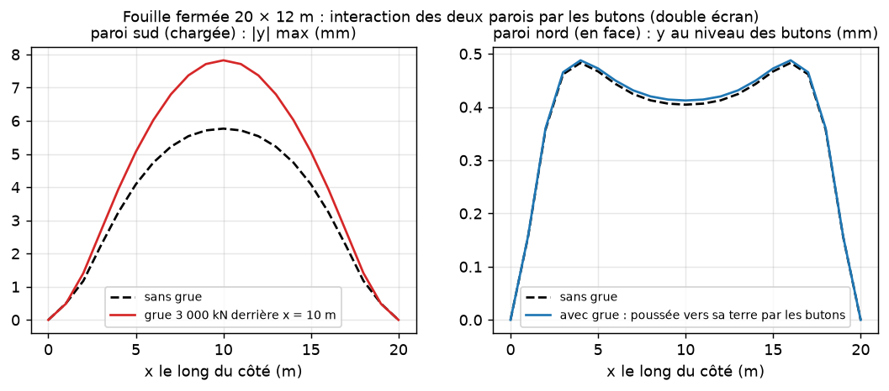

## Limites du modèle (à garder en tête en lisant les résultats)

- Poutre d'Euler-Bernoulli : pas de déformation d'effort tranchant (écrans élancés), plaque mince de Huber à ν = 0 (le terme de Poisson 2νD est négligé ; pour un béton ν ≈ 0,2).
- Sol en ressorts de Winkler indépendants (méthode aux coefficients de réaction) : pas de diffusion dans le massif, pas d'effet de voûte autre que celui de la plaque.
- Angles de la fouille fermée monolithiques (rotation continue, déplacement nul) ; l'option d'angle articulé n'existe pas.
- Appuis ponctuels : Ms et V au droit d'un buton dépendent du maillage tant que pseudo3d.largeur_appui n'est pas donnée.
- Charges du sol et de l'eau concentrées aux nœuds dans le système résolu (erreur mesurée 9e-5 sur la flèche d'une console au pas 0,1 m) ; les diagrammes M et V sont calculés par la statique avec les charges réparties.
- Rigidité horizontale par défaut : paroi moulée Ds = Dz (panneaux continus sauf paroi.longueur_panneau), palplanches, pieux et berlinoise Ds = 0 (serrures et recouvrements libres : hypothèses, modifiables par pseudo3d.rigidite_horizontale).

## Correspondance des conventions avec RDM7

| Grandeur | RDM7 | RetainWall |
|---|---|---|
| Abscisse le long de la poutre | x (horizontale) | z (verticale, vers le haut pour un écran) |
| Flèche positive | vers le bas (sens des charges) | y vers la fouille (sens des poussées) |
| Moment positif | fibre inférieure tendue | face côté fouille (+y) tendue : M = −EI·y'' |
| Effort tranchant | T = dM/dx | V = dM/dz = somme des charges situées au-dessus de la section |
| Travée sur deux appuis chargée | M = +qL²/8 au milieu | M = +qL²/8 au milieu (même signe) |
| Console chargée en bout | M = −PL à l'encastrement | M = −PL à l'encastrement (même signe) |

Les tests `backend/tests/validation/test_rafale_poutres.py` et `test_rafale_elementaire.py` rejouent ces cas à chaque exécution de `lancer_tests.ps1`.
